# 직구레이더 설치와 첫 검사

**새 상품을 검사하려면 배포용 확장만 설치하세요.** 팀 서버가 검사를 실행하므로 내 컴퓨터에는 Python이나 GPU가 필요하지 않습니다. 서버 주소도 입력하지 않습니다. 촬영한 검사를 다시 보거나 내 컴퓨터에서 서버를 실행하려는 사람만 아래 로컬 설치 절차를 따르세요.

## 가장 쉬운 길: 배포용 확장만 넣기

1. 안내받은 저장소 ZIP을 내려받아 압축을 풉니다. 압축을 푼 폴더 안에서 **extension-deployed**를 찾습니다.
2. Chrome 주소창에 `chrome://extensions`를 입력합니다. “개발자 모드”를 켠 뒤 “압축해제된 확장 프로그램 로드”를 누릅니다.
3. **extension-deployed 폴더 자체**를 선택합니다. 이 확장에는 팀 서버 주소가 들어 있습니다. 이름이 비슷한 `extension`은 내 컴퓨터에서 서버를 실행할 때 씁니다.
4. Chrome 도구 모음에서 퍼즐 모양 아이콘을 누릅니다. “직구레이더” 옆 핀을 누릅니다.
5. [Nitrotest 상품](https://kr.iherb.com/pr/musclemeds-nitrotest-androgenic-pre-workout-amplifier-blue-raspberry-16-72-oz-474-g/120411)을 엽니다. 상품명과 성분표가 보이면 확장 아이콘을 누릅니다. 옆 패널에서 “페이지 검사”를 누릅니다. **서버 칸은 바꾸지 마세요.**
6. 새 Chrome 프로필에서 이 상품을 검사했을 때 패널에 “등록 보류 권고”가 나왔습니다. 차단 근거는 **6행이지만 서로 다른 공식 성분은 4개**입니다. 같은 성분이 한국어와 영어로 두 번씩 나온 행이 있기 때문입니다. 앱이 읽은 성분 34개 중 8개는 더 확인해야 했습니다. 제품 전체를 확인했거나 안전하다고 판정한 것이 아닙니다. 사이트가 보안 확인 화면을 띄우면 같은 검사를 할 수 없습니다. 사진을 쓰려면 아래 3장의 사진 검사 절차를 따르세요.

**팀 서버는 2026-11-20 오후 2시(14:00, 한국 시간)까지 사용할 수 있습니다.** 사용 시간이 끝나면 서버는 `모델 서버 꺼짐: 승인된 데모 사용 시간이 종료되었습니다`와 503을 반환합니다. 그 뒤에도 아래 1-가를 따르면 GPU 없이 기록을 볼 수 있습니다.

공유 서버는 평균 **분당 60요청**을 받습니다. 한 번에 몰린 요청에는 20요청의 여유가 있습니다. 한도를 넘기면 서버가 429로 거절합니다. 모든 사용자가 이 한도를 함께 쓰며, 조회와 상태 확인도 요청에 포함됩니다. 서버가 429를 반환하면 단추를 반복해서 누르지 말고 기다렸다 다시 시도하세요.

예전에 설치했다면 확장 카드에서 “새로고침”을 누르고 옆 패널을 닫았다 다시 여세요. 예전에 저장한 주소가 있으면 확장이 그 주소를 먼저 씁니다. 팀 서버로 돌아가려면 배포용 패널의 “작업 설정”에서 “서버” 칸을 비우고 다른 곳을 누르세요. 패널을 닫았다 다시 엽니다. 로컬용 확장에서 같은 절차를 따르면 내 컴퓨터의 8000 포트로 연결되므로 먼저 폴더를 확인하세요.

두 확장의 아이콘 이름은 같습니다. 혼동하지 않도록 이번에 쓸 확장만 켜세요. 사용자는 배포용 서버의 기본 주소만 공개하도록 승인했습니다. 팀은 개인 키나 모델 서버 주소를 공개하지 않습니다.

### 화면을 보며 따라 하기

① 오른쪽 위 개발자 모드를 켭니다.

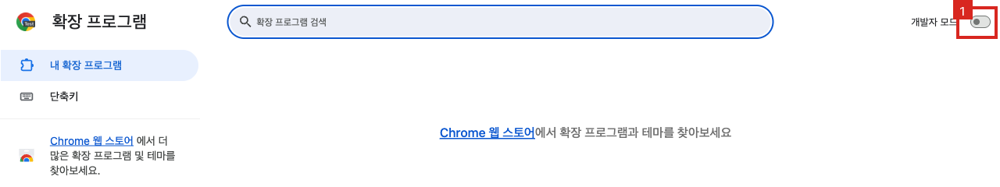

② 압축해제된 확장 프로그램 로드를 누릅니다.

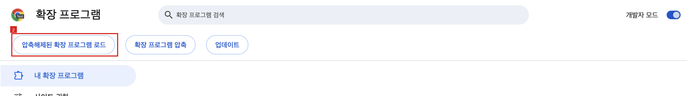

③ `extension-deployed` 폴더 자체를 선택하세요. 이 그림은 실제 폴더 선택창입니다. 저장소의 맨 위 폴더는 선택하지 마세요. 팀은 이 창에서 선택을 마치는 단계를 자동으로 검증하지 못했습니다. 아래 시험에서는 Chrome 시작 옵션으로 같은 폴더를 불러왔습니다.

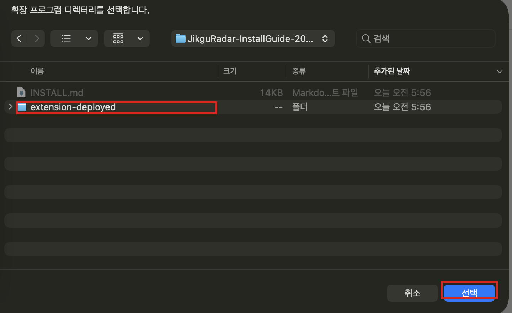

④ 목록에 직구레이더가 생겼는지 확인합니다.

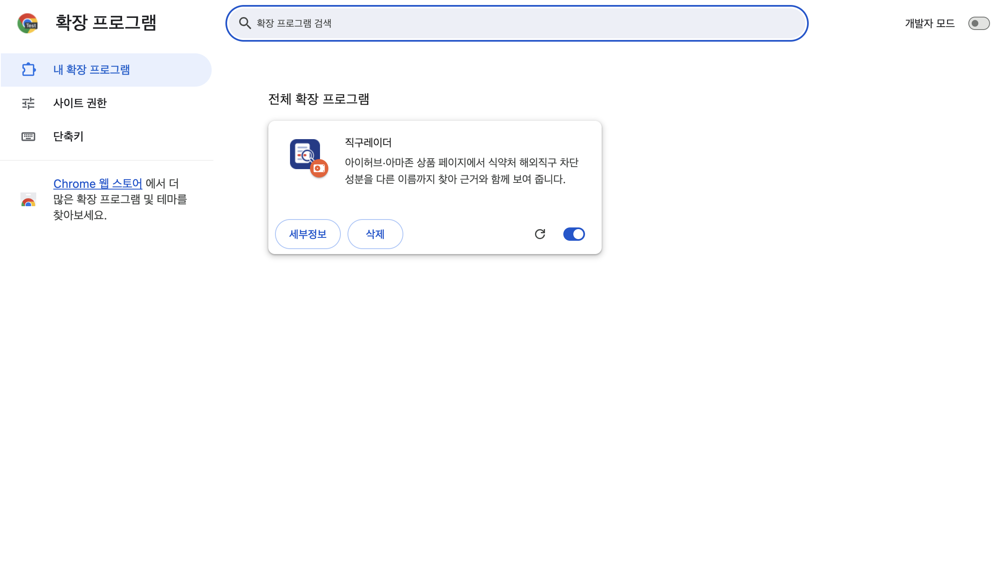

⑤ 퍼즐 메뉴에서 핀을 누르거나 확장 카드의 “세부정보”를 열어 “툴바에 고정”을 켜세요. 아래 화면에서는 팀이 세부정보에서 직접 켰습니다.

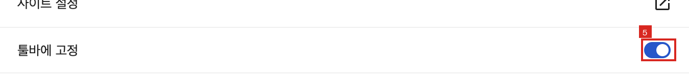

⑥ 상품을 연 뒤 **페이지 검사**를 한 번 누릅니다. ⑦은 사진 검사로 들어가는 단추입니다.

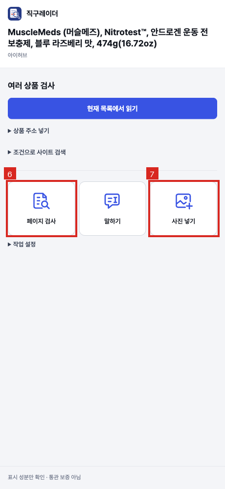

새 프로필에서 실제 상품을 검사하자 앱이 **L-citrulline, Deanol, L-dopa, Yohimbine**을 찾았습니다. 같은 성분이 다른 언어로도 적혀 있어 차단 근거 여섯 행이 나왔습니다. 아래 화면에는 더 확인할 항목 8개도 남아 있습니다.

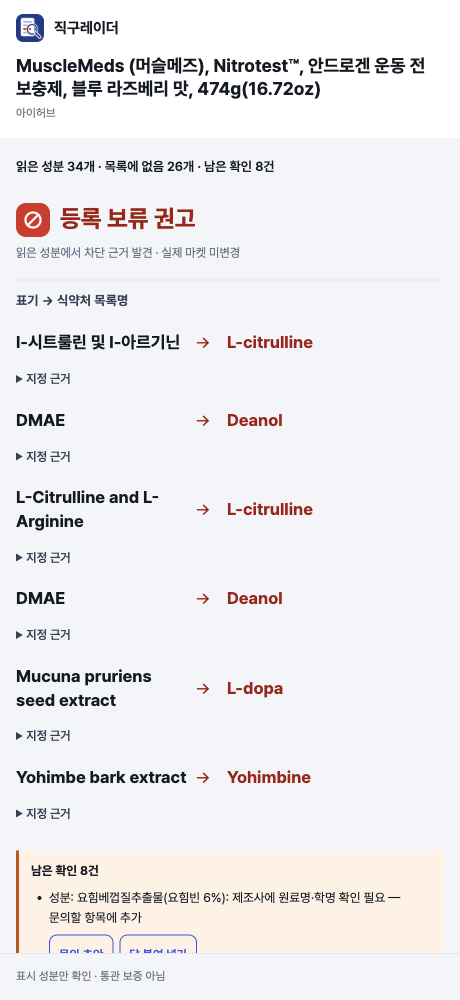

## 직접 돌리는 길: 로컬 서버와 원본 확장

## 0. 내 컴퓨터에서 실행할 때만 준비할 것

**배포용 확장을 쓰는 사람은 여기서 멈추세요.** Chrome과 확장 폴더만 있으면 됩니다. 아래 Python과 터미널은 저장한 기록을 재생하거나 로컬 서버를 켤 때만 필요합니다.

- 데스크톱 Google Chrome을 사용하세요. 휴대전화 Chrome에는 이 확장을 설치할 수 없습니다.
- Python **3.12 이상**과 pip를 준비하거나 uv를 사용하세요. 터미널에서 `python3 --version`을 실행하면 Python 버전을 볼 수 있습니다. 처음 설치할 때는 인터넷에 연결하세요.
- 저장소 안내 페이지에서 “Code”를 열고 “Download ZIP”을 누르세요. 내려받거나 따로 전달받은 ZIP은 실행하기 전에 압축을 푸세요.
- `README.md`, `judge.sh`, `.env.example`, `extension` 폴더가 함께 있는 위치가 시작 폴더입니다. 터미널을 그 폴더에서 엽니다. 폴더 이름은 바꾸어도 되지만 확장을 설치한 뒤에는 옮기거나 지우지 마세요.
- 아래 명령은 macOS 또는 Linux에서 Bash나 zsh로 실행합니다. 팀은 Windows 전용 설치 절차를 검증하지 않았습니다.

## 1. 저장한 검사를 재생하거나 실제 모델 서버에 연결하기

### 가. GPU나 키 없이 세 장면을 다시 보기

시작 폴더에서 실행합니다.

```sh
bash judge.sh
```

처음에는 Python 환경과 필요한 패키지를 설치하므로 잠시 기다립니다. 세 상품의 결과와 `http://127.0.0.1:8000`이 나오면 브라우저에서 그 주소를 엽니다. **‘GPU 없이 촬영 응답 재생’**이라는 제목과 각 상품의 **‘새 사건 로그’**를 확인합니다. 터미널은 닫지 않습니다.

- 재생할 때도 앱은 새 사건을 만들고 코드를 실행해 성분 이름을 공식 이름과 대조합니다.
- 모델의 판단, 문의 문안, OCR 응답은 녹화 때 저장한 답을 씁니다. 묶음에는 원본 사진 대신 사진을 구별하는 그림이 들어 있습니다.
- 재생에는 GPU가 필요 없습니다. 새 쇼핑몰 페이지나 새 사진은 검사할 수 없으므로 이 모드에서는 “페이지 검사”를 누르지 마세요.
- 브라우저가 자동으로 열리지 않아도 실패가 아닙니다. 출력된 로컬 주소를 직접 여세요.
- `.env`는 읽지 않습니다. 창 없이 세 기록만 확인하려면 `bash judge.sh check`를 씁니다. 이 명령은 확인 후 종료합니다.

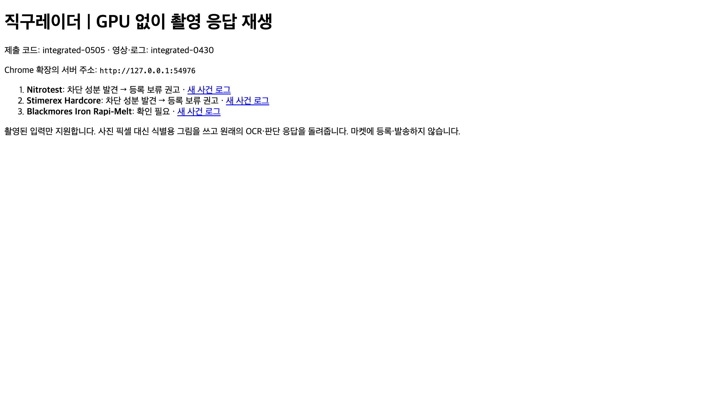

검증에서는 기존 서버를 지키기 위해 54976 포트를 썼습니다. 일반 설치에서는 위 기본값 8000을 사용합니다.

### 나. 내 컴퓨터에서 Zoro-1과 글자 읽기 서버에 연결하기

모델 운영자에게 추론 서버 주소를 받고 키가 필요한지 확인하세요. 서버는 Zoro-1으로 성분표를 판단하고 문의 문안을 만들 수 있어야 합니다. 글자는 GravityOCR-KO로 읽습니다. 이 저장소는 GPU나 모델을 설치해 주지 않습니다.

처음 한 번만 실행합니다. 이미 `.env`가 있으면 덮어쓰지 말고 기존 파일을 편집하세요.

```sh
cp .env.example .env
```

텍스트 편집기로 `.env`를 열어 아래 항목을 바꿉니다. 주소와 키의 실제 값은 이 설명서에 없습니다.

| 항목 | 넣을 내용 |
|---|---|
| `ZORO_MODE` | `remote` |
| `ZORO_URL` | 운영자에게 받은 모델 서버 주소를 넣습니다. 내 컴퓨터에서 쓰는 앱의 8000 포트가 아닙니다. |
| `ZORO_API_KEY` | 서버가 인증을 요구하면 키를 넣습니다. 요구하지 않으면 비워 둡니다. |
| `OCR_ENGINE` | `remote` |

주소나 키에 공백이나 셸 특수문자가 있으면 값을 따옴표로 감싸세요. `.env`는 내 컴퓨터에만 두세요. 파일을 공유하거나 저장소에 올리거나 내용이 보이는 화면을 캡처하지 마세요.

같은 터미널에서 다음 명령을 실행하세요. **judge.sh는 .env를 자동으로 읽지 않습니다.** 앞의 세 줄을 실행해야 마지막 명령에서 설정을 쓸 수 있습니다.

```sh
set -a
. ./.env
set +a
JUDGE_PORT=8000 bash judge.sh live
```

터미널에 “실제 GPU 연결 설정”과 로컬 주소가 나오면 내 컴퓨터의 서버가 켜진 것입니다. 모델 서버가 응답했는지는 첫 검사가 끝나야 알 수 있습니다. GPU가 꺼져 있거나 인증이 틀리면 검사는 실패합니다. 앱은 저장한 답을 대신 보여 주지 않습니다.

개발용 `bash run.sh`도 `.env`를 읽지만 설정이 다릅니다. `.env` 없이 실행하면 기본값은 `mock`이므로 이 안내에서는 쓰지 않습니다. `record`는 기존 답을 재생하지 않고 새 호출을 기록합니다.

### 로컬 서버가 켜졌는지 확인하기

Chrome 주소창에 **http://127.0.0.1:8000/health** 를 입력합니다. 화면에서 `"ok": true`, `"zoro_mode": "remote"`를 찾습니다.

**`remote`만 보고 실제 GPU가 응답했다고 판단하지 마세요.** 재생할 때도 내부 연결에는 같은 값이 나옵니다. 시작 화면의 제목을 보거나 `/judge/results`를 확인하세요. 재생이면 `"mode": "recorded-upstream"`, 실검사면 `"mode": "live"`입니다.

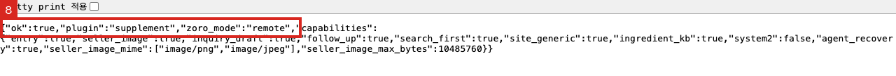

## 2. 로컬 서버를 쓸 때 Chrome에 확장 설치하기

1. Chrome 주소창에 **chrome://extensions**를 입력하고 Enter를 누릅니다. 검색창이 아닌 주소창입니다.
2. 오른쪽 위 **개발자 모드**를 켭니다.
3. **압축해제된 확장 프로그램 로드**를 누릅니다. Chrome 언어가 영어라면 **Load unpacked**입니다.
4. 받은 폴더 안의 **extension 폴더 자체**를 선택합니다. `manifest.json` 파일 하나나 저장소 전체 폴더를 선택하지 마세요. 올바른 폴더 안에는 `manifest.json`, `sidepanel.html` 등이 있습니다.
5. 목록에 **직구레이더**가 생기고 켜짐 상태인지 확인합니다.
6. 툴바의 퍼즐 모양 **확장 프로그램**을 누르고, **직구레이더** 옆 핀을 눌러 고정합니다.

이미 설치했다면 새 폴더를 계속 중복 등록하지 마세요. `chrome://extensions`의 직구레이더 카드에서 **새로고침(둥근 화살표)**을 누릅니다. 열려 있던 옆 패널을 닫고 다시 열며, 상품 탭도 새로고침합니다. 이름이 같은 카드가 여러 개라면 이번에 받은 폴더의 확장만 켭니다.

## 3. 로컬 서버를 실제 모델에 연결한 뒤 첫 상품 검사하기

### 상품 페이지 검사

1. [MuscleMeds Nitrotest 474 g 상품](https://kr.iherb.com/pr/musclemeds-nitrotest-androgenic-pre-workout-amplifier-blue-raspberry-16-72-oz-474-g/120411)을 엽니다.
2. 상품명과 성분표가 보이는지 확인하세요. **보안 확인이나 접속 거절 화면은 상품 페이지가 아닙니다.** 그 화면을 우회하지 마세요. 상품 페이지를 열 수 없으면 1-가에 따라 기록을 재생하세요.
3. 상품 탭이 선택된 상태에서 툴바의 **직구레이더 아이콘**을 누릅니다. 오른쪽 옆 패널이 열립니다. `chrome://extensions` 탭에서 페이지 검사를 하지 않습니다.
4. **로컬용 `extension`을 쓸 때만** 패널의 “작업 설정”을 열고 “서버” 칸이 `http://127.0.0.1:8000`인지 확인하세요. 값을 바꿨다면 다른 곳을 눌러 입력을 마치세요. GPU 주소나 다른 포트는 넣지 마세요. **배포용 `extension-deployed`에서는 기본 주소를 그대로 두세요.**
5. **페이지 검사**를 한 번 누르고 기다립니다. 서버에 요청했다는 상태와 실제 결과는 다릅니다. 응답이 늦다고 계속 누르지 마세요.
6. 팀이 보관한 Nitrotest 영문 성분표에서는 “등록 보류 권고”와 차단 근거 네 가지가 나왔습니다. 앱은 DMAE를 공식 이름인 **Deanol**과 연결했습니다. 지금 사이트가 보여 주는 내용이나 언어, 제품 배합이 다르면 결과도 달라질 수 있습니다.

앱이 찾은 네 원료는 L-citrulline, Deanol, L-dopa, Yohimbine입니다. “표시 성분 검토 완료”는 앱이 읽은 성분을 확인했다는 뜻입니다. 판매나 통관을 승인한 것이 아닙니다.

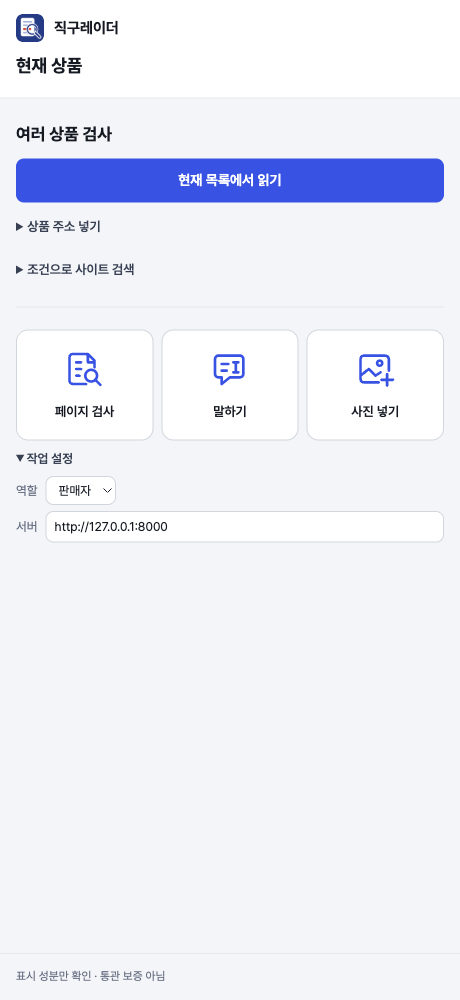

이 그림은 로컬 주소 설정 예시입니다. 배포용 검사 당시에는 기본 배포 주소를 바꾸지 않았습니다.

### 사진으로 검사하기

1. 실검사 서버가 켜진 상태에서 패널의 **사진 넣기**를 누릅니다.
2. 사용할 권한이 있는 PNG 또는 JPEG 성분표 사진을 고르세요. 제품 앞면 사진만으로는 전체 성분을 확인할 수 없습니다. PDF 파일은 올릴 수 없습니다.
3. 선택한 사진을 확인한 뒤 **이 사진 검사**를 누릅니다.
4. 앱이 사진에서 읽을 곳을 물으면 성분표가 있는 부분을 고르세요. 어디인지 모르면 “모름 · 나중에”를 누르세요. 직접 확인하지 않은 답은 입력하지 마세요.
5. 사진이 흐리거나 성분표가 잘리면 앱은 “직접 확인 필요”를 남깁니다. 새로 받은 자료가 있다면 “답 붙여 넣고 이어서 확인”을 누른 뒤 “같은 검사 다시 판단”을 누르세요.

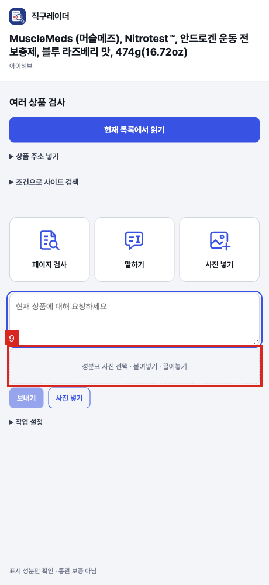

이번 새 프로필 확인에서는 사진 선택 화면까지만 확인했습니다. 새 사진 업로드·OCR 판정은 다시 실행하지 않았습니다.

## 4. 안 될 때

| 화면에 무엇이 보이나요? | 무엇을 확인하면 되나요? |
|---|---|
| **검사 전 · 실제 검사 서버 연결 필요** | 서버가 꺼졌거나, 주소가 다르거나, `mock` 모드일 수 있습니다. 1장의 `/health`를 먼저 열어 확인하세요. 서버 칸을 고치고 패널을 닫았다 다시 엽니다. |
| **실제 검사 서버에 연결한 뒤 시작하세요.** | 서버 준비 확인이 끝나지 않았습니다. 위와 같은 순서로 확인합니다. |
| **상품 상세 페이지가 아닙니다. 상품을 연 뒤 다시 검사** | 상품 탭 대신 검색 결과·설정 탭·보안 확인 화면을 읽었을 수 있습니다. iHerb/Amazon 상품 상세 탭에서 상품명과 성분표가 보이는지 확인하고 다시 엽니다. 보안 확인은 우회하지 않습니다. |
| 아이콘을 눌러도 아무 반응이 없음 | 확장이 켜져 있는지, 올바른 폴더인지, 핀이 고정되었는지 확인합니다. 개발자 모드 화면에서 새로고침하고 상품 탭·패널을 다시 엽니다. 회색 검사 단추는 서버부터 확인합니다. |
| 서버 칸에 예전 주소가 남음 | 배포용은 **서버 내용을 지우기 → 다른 곳 누르기 → 패널 닫고 다시 열기**로 기본값을 복원합니다. 로컬용은 `http://127.0.0.1:8000`으로 바꿉니다. 원격 GPU 주소를 넣지 않습니다. 새로고침만으로 저장 주소가 지워지지 않습니다. |
| 터미널에 **Address already in use** 또는 **address already in use** | 8000 포트를 다른 서버가 쓰고 있습니다. 먼저 `/health`를 확인합니다. 내 서버라면 해당 터미널에서 Ctrl+C로 끕니다. 모르는 프로세스를 강제 종료하지 마세요. 기존 서버를 써야 하는 상황이면 관리자에게 확인합니다. |
| 파일을 바꿨는데 이전 화면이 나옵니다 | 파일을 저장해도 확장이 자동으로 바뀌지는 않습니다. 확장 카드에서 새로고침을 누르고 옆 패널을 닫았다 다시 여세요. 마지막으로 상품 탭을 새로고침하세요. |
| **실제 GPU 주소가 필요합니다: ZORO_URL을 먼저 설정하세요.** | `.env`를 만들었어도 현재 셸에 적용하지 않은 경우입니다. 1-나의 `set -a`부터 다시 실행합니다. |
| 재생 중에 새 사진을 검사할 수 없습니다 | 재생은 녹화 때 넣은 자료와 저장한 답만 사용합니다. 새 사진을 검사하려면 실제 모델 서버에 연결하세요. |
| **확장 프로그램을 로드하지 못함**, **매니페스트 파일이 없거나 읽을 수 없습니다**, **매니페스트를 로드할 수 없습니다.** | 저장소 전체 폴더를 선택했을 때 실제로 확인한 오류입니다. 취소한 뒤 `manifest.json`이 바로 들어 있는 `extension-deployed` 또는 `extension` 폴더 자체를 다시 선택합니다. |

원본 `extension`의 서버 허용 주소는 **127.0.0.1 또는 localhost의 8000 포트뿐**입니다. 이 안내는 `127.0.0.1`로 통일합니다. 배포용 복사본에는 배포 서버 권한도 포함되어 있습니다. 다른 주소를 적는 것만으로 권한이 생기지 않습니다. 확장 새로고침은 이미 저장된 서버 주소를 지우는 기능이 아닙니다.

## 5. 끄는 법

서버를 실행한 터미널에서 **Ctrl+C**를 누르면 내 컴퓨터의 서버가 꺼집니다. judge가 만든 임시 사건과 기록도 이때 지워집니다. 이 명령은 원격 GPU를 끄지 않으므로 사용 시간과 요금은 운영자에게 확인하세요. 옆 패널만 닫으면 서버는 계속 켜져 있습니다. 확장 자체는 `chrome://extensions`의 스위치로 끌 수 있습니다.

## 새 폴더와 새 Chrome 프로필로 어디까지 확인했나요?

팀은 2026-11-20에 macOS에서 별도의 Chrome for Testing 프로필로 검사했습니다. 평소 쓰는 Chrome과 기존 8000 서버는 그대로 두었습니다. 팀은 이미 가지고 있던 저장소 폴더를 새 위치에 복사해 사용했습니다. GitHub에서 내려받는 단계는 시험하지 않았습니다.

| 확인한 것 | 실제 결과 |
|---|---|
| 새 폴더에서 `judge.sh` 실행 | 팀은 새 Python 3.12.11 환경에서 필요한 패키지를 설치하고 GPU 없이 저장한 응답 3건을 재생했습니다. 기존 서버가 8000 포트를 쓰고 있어 시험에는 54976 포트를 썼습니다. |
| 배포용 기본 주소로 첫 상품 검사 | 팀은 새 프로필에서 서버 칸을 바꾸지 않고 실제 iHerb Nitrotest 페이지를 검사했습니다. 사건 `1119-210743-9f76`에서 서버가 기록한 시간은 39.604초였고 모델 호출은 17회였습니다. 저장한 페이지나 모델 응답을 쓰지 않았습니다. |
| 실제 상품에서 찾은 성분 | 패널에 “등록 보류 권고”가 나왔습니다. 차단 근거 6행은 서로 다른 공식 성분 4개에 해당했습니다. 앱이 읽은 성분 34개 중 8개는 더 확인해야 했습니다. 이 결과는 통관이나 안전을 보증하지 않으며, 지금 판매하는 제품의 배합이 같다는 뜻도 아닙니다. |
| 서버 연결과 주소 복원 | 앱은 팀 서버에서 새 검사를 만들고 결과를 조회했으며 진행 상황도 같은 서버에서 받았습니다. 팀은 전에 입력한 주소가 재시작 뒤에도 남는지 확인했습니다. 서버 칸을 비우면 기본 주소가 돌아오는 것도 확인했습니다. |
| 설치 확인에서 빠진 단계 | 팀은 폴더 선택창을 자동으로 조작하지 못해 허용된 `--load-extension` 옵션으로 설치했습니다. 사람이 폴더를 골라 설치를 마치는 단계는 검증하지 못했습니다. 팀은 실제 확장 패널을 별도 탭에서 열어 검사 단추를 눌렀습니다. 툴바 아이콘으로 옆 패널을 여는 단계는 시험하지 않았습니다. |
| 사진과 로컬 서버에서 확인하지 않은 것 | 팀은 사진 선택 화면까지 확인했지만 새 사진으로 OCR을 호출하지 않았습니다. 새 폴더에서 `.env`로 로컬 서버를 켜 실제 모델에 연결하는 과정도 이번에는 실행하지 않았습니다. 저장한 기록의 재생과 배포 서버의 실제 검사는 각각 확인했습니다. |

연결이 끊긴 동안 앱은 다시 연결을 요청했습니다. 팀은 연결이 돌아온 뒤 최종 결과를 확인했습니다. 실패 화면을 성공 화면으로 바꾸거나 DOM에 결과를 넣지 않았습니다. 그림은 실제 캡처에서 필요한 부분을 잘라 누를 곳만 표시한 것입니다. 개인 폴더 위치는 가렸습니다. 설치 화면과 결과 화면은 서로 다른 시점에 촬영했습니다.
