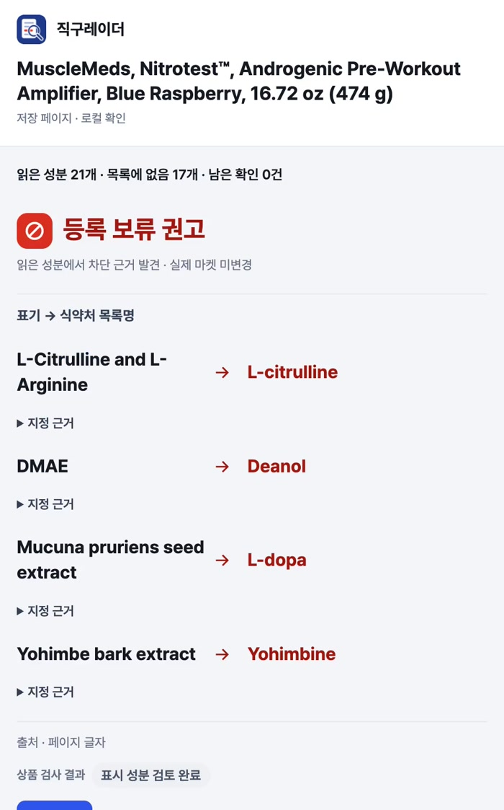

# 직구레이더

직구레이더는 해외 영양제를 쇼핑몰에 등록하기 전에 판매자가 성분표를 확인하는 Chrome 확장 프로그램입니다. 직구레이더는 상품 설명이나 포장 사진에서 읽은 이름을 식품의약품안전처의 국내 반입차단 대상 원료와 대조합니다. 맞는 원료를 찾으면 상품 표기와 식약처 지정명을 나란히 보여 줍니다. 성분표가 잘렸거나 흐리면 판매자에게 무엇을 더 확인해야 하는지 알려 줍니다. **이 도구는 판매나 통관을 승인하지 않습니다.**

**심사위원이 볼 수 있는 것 네 가지**

| 보고 싶은 것 | 어디에서 무엇을 확인하나요? | 걸리는 시간 |
|---|---|---|
| 발표와 영상 보기 | 팀이 발표 자료와 영상을 별도로 전달합니다. [영상 해설과 자막](submission/demo/README.md)은 여기서 볼 수 있습니다. 영상은 실제로 앱을 실행해 찍었습니다. 지금 새로 검사하는 화면은 아닙니다. | 발표 자료에 넣은 영상은 **1분 46.68초**입니다. 이 저장소의 영상 해설은 설명 카드 두 장이 들어 있던 1분 56.68초 판을 기준으로 썼고, 세 검사 장면의 내용은 같습니다. 발표 자료를 읽는 시간은 별도입니다. |
| 코드와 실행 로그 3종 읽기 | [제출한 코드](nextask/)와 영상을 찍을 때 남긴 기록을 보세요. ① 본문 성분표를 읽은 검사: [원문](submission/logs/scenario-01.jsonl), [해설](submission/logs/scenario-01.md). ② 옆으로 누운 라벨을 읽은 검사: [원문](submission/logs/scenario-02.jsonl), [해설](submission/logs/scenario-02.md). ③ 같은 상품의 라벨을 더 받아 이어 간 검사: [원문](submission/logs/scenario-03.jsonl), [해설](submission/logs/scenario-03.md). | 설치할 필요가 없습니다. 당시 세 검사는 각각 **12.8초, 32.1초, 43.5초** 걸렸습니다. |
| GPU 없이 세 검사 재생하기 | 저장소 맨 위 폴더에서 `./judge.sh`를 실행하세요. 앱은 세 검사를 처음부터 다시 합니다. 모델이 골랐던 답과 사진에서 읽은 글은 당시 기록을 사용합니다. [실행 안내](START_HERE_KO.md) | 새 폴더에서 `./judge.sh check`로 세 건을 재생하는 데 **19.85초** 걸렸습니다. 창은 띄우지 않았고 패키지는 미리 내려받았습니다. 처음 내려받는 시간은 별도입니다. |
| 내 상품 직접 검사하기 | [배포용 확장](#배포용-확장만-넣으면-됩니다)을 설치한 뒤 Chrome에서 상품 탭을 여세요. 이때는 **실제 모델이 새 입력을 검사합니다**. 서버 주소를 입력하거나 내 컴퓨터에서 서버를 켤 필요가 없습니다. | 서버가 보관해 둔 Nitrotest 자료 1건을 처리하는 데 **약 12초** 걸렸습니다. 설치하거나 상품을 열고 기다린 시간은 뺐습니다. 새 상품에서는 시간이 다를 수 있습니다. |

**아직 확인하지 못한 점:** 실제 한국어 성분표가 있는 판매 사이트에서 시험하지 않았습니다. 실제 판매자가 참여한 시험도 아닙니다. 단순히 사진을 한 번 읽어 대조한 방법보다 금지 원료를 더 잘 찾았다는 결과는 없습니다.

## 왜 성분표를 끝까지 확인해야 하나요?

어떤 판매자는 성분을 본문에 표로 싣습니다. 어떤 상품은 옆으로 누운 포장 사진 속 작은 글씨가 전부입니다. 앱이 앞면이나 주의문구에서 차단 성분을 찾지 못해도 뒷면까지 확인한 것은 아닙니다. 그래서 검사 결과 패널에는 “등록 보류 권고”, “읽은 성분에 일치 없음”, “직접 확인 필요” 중 하나가 나타납니다. 차단할 근거를 찾았더라도 확인하지 못한 부분을 함께 보여 줍니다.

## 화면에서 상품 표기와 식약처 지정명 비교하기

실제 Chrome 화면에서 확장 패널만 잘랐습니다. 왼쪽에는 상품에 적힌 성분명이, 오른쪽에는 같은 원료의 식약처 지정명이 나옵니다. 앱이 등록을 미루라고 안내해도 쇼핑몰의 등록 상태는 바뀌지 않습니다.

## 코드와 두 모델은 각각 무슨 일을 하나요?

코드는 페이지에서 글을 꺼내고 성분명을 식약처의 정식 이름이나 다른 이름과 대조합니다. 글이 모자라면 판매자에게 사진이나 제조사 설명을 요청합니다. **GravityOCR-KO**는 사진 속 글자를 읽습니다. 사진을 돌릴지는 글자 읽기 도구 안에서 정합니다. **Zoro-1**이 맡은 일은 아래 다섯 가지입니다. 수치는 [영상을 찍을 때 남긴 기록](submission/README.md)에서 모델이 각 보기에 준 점수입니다. 상품이 안전할 확률이나 모델의 정답률이 아닙니다.

| Zoro-1에 맡긴 일 | 실제 답과 코드가 한 일 |
|---|---|
| 지금 보이는 자료를 성분표로 읽을 수 있나요? | 모델이 ‘읽을 만함’에 준 점수는 본문 표에서 0.9428, 사진에서 0.9479였습니다. 앞면만 찍은 사진에서는 ‘읽을 만하지 않음’에 0.8504를 줬습니다. 코드는 검사를 완료한 것으로 처리하지 않았습니다. |
| 어떤 종류의 상품으로 보이나요? | 운동 보충제에서 모델이 “해외 영양보충제 표기”에 준 점수는 0.5647이었습니다. 프로그램은 분류 단서로 기록했고 법적 품목 분류로 확정하지 않았습니다. |
| 이름만으로 구분하기 어려운 성분이 식약처의 특정 원료와 같은가요? | 베타알라닌에서 모델이 ‘해당 후보 없음’에 준 점수는 0.9894였습니다. 반면 Nitrotest에 적힌 DMAE와 식약처 지정명 Deanol을 연결한 것은 모델이 아니라 코드입니다. |
| 부족한 자료를 어떻게 요청할까요? | 제품 앞면만 있는 사례에서 Zoro-1이 제조사에 보낼 영문 문의 초안을 썼습니다. 코드는 초안을 검사해 표시했고 실제로 발송하지 않았습니다. |
| 새로 받은 라벨에서 무엇을 더 확인할 수 있나요? | 모델은 같은 상품에서 철과 비타민 C를 다시 살폈습니다. 두 성분의 ‘차단 근거 없음’ 점수는 각각 0.9464와 0.9700이었습니다. 다른 항목은 사람이 확인해야 해서 앱은 상품 전체를 통과시키지 않았습니다. |

영상에 나온 세 검사에서 **다음 행동은 코드가 정했습니다.** 이 시험은 모델 스스로 순서를 정했을 때 성적이 오르는지 측정하지 않았습니다.

## 실행 방법 세 가지

1. **GPU 없이 세 검사를 재생할 때**는 Python 3.12 이상과 `uv` 또는 `pip`를 준비하세요. 압축을 푼 폴더에서 `./judge.sh`를 실행하세요. 첫 설치에는 인터넷이 필요합니다. 앱은 새 검사를 시작한 뒤 당시 모델의 답과 사진에서 읽은 글을 사용해 성분명을 다시 대조합니다. 새 사진을 읽지는 않습니다. 창을 열지 않고 결과만 보려면 `./judge.sh check`를 쓰세요. [시작 안내](START_HERE_KO.md)
2. **내 GPU로 새 상품을 검사할 때**는 먼저 Zoro-1이 판단하고 문장을 쓰며 GravityOCR-KO가 글자를 읽을 수 있는 서버를 켜세요. 셸에 `ZORO_URL`을 설정하고, 키가 필요하면 `ZORO_API_KEY`도 설정하세요. `JUDGE_PORT=8000 ./judge.sh live`를 실행하세요. 주소와 키는 공유 파일에 적지 마세요. 이 저장소는 GPU를 마련하거나 모델 가중치를 설치해 주지 않습니다. [서버에 필요한 기능](submission/infra.md)
3. **로컬 서버 없이 새 상품을 검사합니다.** [배포용 확장](#배포용-확장만-넣으면-됩니다)에는 데모 서버가 기본값으로 지정돼 있습니다.

`./run.sh scenarios`는 개발용 예제입니다. 이 예제가 사용하는 외부 라벨 원본은 배포하지 않습니다. 영상에 나온 세 검사를 재생할 때는 `./judge.sh`를 쓰세요.

## 심사위원이 직접 따라 하기

[실제로 검사한 상품 25개](submission/cases.md)에서 원래 라벨을 열어 보세요. 금지 성분이 있는 상품 17개와 앱이 그 성분을 놓친 4개의 이유를 확인할 수 있습니다. 처음이라면 ③ Stimerex가 좋습니다. 미국 국립보건원(NIH)의 라벨이 열리는 것을 확인했습니다.

**가. Chrome에 설치하세요.** [설치 설명서](INSTALL.md)에서 사용할 방법을 고르세요. 팀이 배포한 서버를 쓰려면 [`extension-deployed/`](extension-deployed/)를 선택하세요. 내 컴퓨터에서 서버를 켰다면 [`extension/`](extension/)을 선택하세요. 아래 연결 진단은 **내 컴퓨터에서 서버를 켰을 때** 사용합니다.

### 안 될 때

먼저 같은 브라우저에서 `http://127.0.0.1:8000/health`를 여세요. `"ok": true`이면 로컬 앱이 응답합니다. 실검사 설정은 `"zoro_mode": "remote"`여야 합니다. 이 응답만으로 상품 검사 요청이 도착했거나 GPU 추론이 끝났다는 뜻은 아닙니다. 주소가 열리지 않으면 바로 아래의 실행 방법으로 로컬 서버를 먼저 켜세요.

| 증상 | 확인할 곳과 다음 행동 |
|---|---|
| 확장을 갱신했는데 예전 패널이 보입니다. | `chrome://extensions`에서 직구레이더의 **새로고침**을 누르세요. 열려 있던 패널을 닫고 상품 탭도 새로고침한 뒤 패널을 다시 여세요. 예전 폴더를 로드했다면 [설치 설명서](INSTALL.md)에서 사용할 판의 폴더를 다시 선택하세요. |
| 서버는 켜져 있는데 검사가 시작되지 않습니다. | 패널의 **작업 설정 → 서버**에 `http://127.0.0.1:8000`이 저장됐는지 확인하세요. 다른 포트나 GPU 서버 주소가 아니어야 합니다. 상품 상세 탭으로 돌아가 **페이지 검사**를 누르세요. |
| 쇼핑몰이 상품 대신 보안 확인을 표시합니다. | 일부 화면에서는 **“상품 상세 페이지가 아닙니다. 상품을 연 뒤 다시 검사”**, 인식된 보안 화면에서는 **“보안 확인 화면입니다. 확인을 마친 뒤 다시 검사”**라고 나옵니다. 사이트의 정상 확인 절차를 직접 마치고 상품명·성분표가 실제로 보일 때 **다시 검사**를 누르세요. 열 수 없으면 우회하지 말고 기록 재생을 사용하세요. |

확장 패널이 상품 페이지가 아니라고 판단하면 서버에는 검사 요청이 가지 않을 수 있습니다. 반대로 서버가 응답해도 검사가 끝났다는 뜻은 아닙니다. [고장 주입 시험](submission/error-behavior.md)에서는 검사가 진행 중으로 남은 5건과 앱이 유효하지 않은 확률을 받아들인 2건을 확인했습니다. 잘못된 응답은 실제 모델이 아니라 시험용 대역 서버가 보냈습니다.

**나. 내 컴퓨터에서 서버를 실행하는 경우에만 터미널을 여세요. 재생과 실검사 중 하나만 켜세요.** Python 3.12 이상과 `uv` 또는 `pip`가 필요합니다. 실행 중에는 터미널을 열어 두고, 방식을 바꿀 때는 먼저 `Ctrl+C`로 종료하세요.

- **GPU와 키가 없을 때:** `./judge.sh`로 영상의 세 검사를 재생하세요. 앱은 검사를 새로 만들고 성분명을 다시 대조합니다. 사진에서 읽은 글과 모델의 답은 당시 기록입니다. 이 명령으로 새 페이지나 사진을 검사할 수는 없습니다.
- **지금 열어 본 상품을 검사하려면:** Zoro-1·GravityOCR-KO 추론 서버가 필요합니다. 저장소 루트에서 `cp .env.example .env`를 실행한 뒤 로컬 `.env`에 `ZORO_MODE=remote`, 자신이 사용할 `ZORO_URL`, 필요한 경우 `ZORO_API_KEY`, `OCR_ENGINE=remote`를 설정하고 `./run.sh`를 실행합니다. 키나 주소를 이 저장소에 올리지 마세요. `.env` 없이 실행하는 `./run.sh`의 기본값은 `mock`으로, 실검사도 영상 기록 재생도 아닙니다. 촬영 재현 설정을 적용한 제출판을 실모델로 쓰려면 위의 `./judge.sh live` 방식을 선택하세요.

**다. 상품을 하나씩 열어 결과를 비교하세요.** 아래 표는 2026-11-20 KST에 보관 자료로 확인한 결과입니다. 지금 링크를 열었을 때도 같은 결과가 나온다는 뜻은 아닙니다. 먼저 패널 위에 올바른 상품명이 보이는지 확인하세요. 사진을 넣을 때는 해당 상품의 사진 중 본인이 사용할 권한이 있는 것을 준비하세요.

| 어떤 상품을 열어 보나요? | 무엇을 누르나요? | 당시 앱은 무엇을 확인했나요? |
|---|---|---|
| 연습 ①, 영상 ① [iHerb: MuscleMeds Nitrotest, 474 g](https://kr.iherb.com/pr/musclemeds-nitrotest-androgenic-pre-workout-amplifier-blue-raspberry-16-72-oz-474-g/120411) | 상품 탭에서 “페이지 검사”를 누르세요. `DMAE → Deanol` 아래의 “지정 근거”를 펼치세요. | 촬영 당시 앱은 21개 항목을 읽고 4개에서 차단 근거를 찾았습니다. 앱은 “등록 보류 권고”를 표시했고, 더 확인할 항목은 0건이었습니다. |
| 연습 ② [iHerb: California Gold Nutrition Gold C, 60캡슐](https://kr.iherb.com/pr/california-gold-nutrition-gold-c-usp-grade-vitamin-c-1-000-mg-60-veggie-capsules/61864) | “사진 넣기”에서 “뒷면 라벨”을 고르고 “이 사진 검사”를 누르세요. 본문을 보려면 따로 “페이지 검사”를 누르세요. | 사진 시험(0255-q)에서 앱은 비타민 C 1종을 대조했습니다. 표 일부를 읽고도 전체를 확인한 것으로 처리하지 않았습니다. 영상 촬영 때는 “페이지 글”로도 따로 검사했습니다. 읽은 성분 3개에서 일치를 찾지 못했습니다. |
| 연습 ③ [iHerb: NOW Foods Garcinia Extract, 120정](https://kr.iherb.com/pr/now-foods-garcinia-extract-120-tablets/55359) | “사진 넣기”에서 “앞면”을 고르고 “이 사진 검사”를 누르세요. 위치를 모르면 “모름 · 나중에”를 선택하세요. “문의 초안”을 열 수 있습니다. 같은 병의 뒷면이 있다면 “답 붙여 넣고 이어서 확인”에 넣고 “같은 검사 다시 판단”을 누르세요. | 이전 촬영에서는 첫 글자 읽기 요청이 실패하도록 설정했습니다. 다음 요청에서 도구가 실제로 글을 읽었지만, 확인하지 못한 성분이 남아 앱은 사람에게 확인을 요청했습니다. 최신 코드로 실제 사이트에서 앞면부터 뒷면까지 이 과정을 재현한 것은 아닙니다. |
| 영상 ② [NIH DSLD: Stimerex Hardcore 라벨 48084 (PDF)](https://api.ods.od.nih.gov/dsld/s3/pdf/48084.pdf) | 판매 페이지가 아니라 과거 제품의 라벨입니다. 사용 권한이 있는 라벨을 PNG나 JPEG로 준비하세요. “사진 넣기”에서 이미지를 선택한 뒤 “이 사진 검사”를 누르세요. PDF를 그대로 올릴 수는 없습니다. | 촬영 당시 앱은 옆으로 누운 사진에서 차단 근거 네 가지를 찾았습니다. 앱은 등록을 미루라고 안내했습니다. 같은 글자가 반복돼 표 전체를 확인하지는 못했습니다. |
| 영상 ③ [Blackmores: Iron Rapi-Melt](https://www.blackmores.com.au/products/iron-rapi-melt) | 앱이 제조사 사이트에서 자동으로 자료를 가져오는 예가 아닙니다. “사진 넣기”로 제품 앞면을 넣으세요. “문의 초안”을 확인하세요. 그 뒤 성분표를 받으면 “같은 검사 다시 판단”을 누르세요. | 촬영 당시 앱은 앞면 사진만 보고 결론을 내리지 않았습니다. 미리 준비한 성분표에서 철과 비타민 C를 대조했지만, 상품에는 “직접 확인 필요”가 남았습니다. 제조사가 실제로 회신한 것은 아닙니다. |

iHerb에서 보안 확인 화면이 떠 상품을 볼 수 없으면 **검사하지 못한 것**입니다. 우회하지 말고 기록 재생을 사용하세요. 링크의 현재 재고·배합·페이지 언어와 당시 입력이 다를 수 있습니다. `kr.iherb.com` 주소가 있어도 한국어 성분표를 실제 사이트에서 검증했다는 뜻이 아닙니다. 기본 확장이 자동으로 읽는 판매 페이지는 iHerb와 Amazon.com입니다.

## 배포용 확장만 넣으면 됩니다

[설치 설명서](INSTALL.md)에 따라 Chrome에서 [`extension-deployed/`](extension-deployed/)를 압축해제된 확장으로 로드하세요. iHerb 또는 Amazon.com 상품 상세 탭에서 직구레이더 패널을 열고 **페이지 검사**를 누르세요. 새 프로필에서는 새 주소를 입력하거나 Python·GPU 서버를 켤 필요가 없습니다.

로컬용 [`extension/`](extension/)과 달리 배포용 확장은 **서버 접근 허용 도메인**과 **패널의 기본 서버 주소**가 배포 서버를 가리킵니다. 상품 대신 보안 확인 화면이 보이면 우회하지 말고 [25개 사례의 원출처와 사진 입력 방법](submission/cases.md)이나 기록 재생을 이용하세요.

- **서버에서 확인한 결과:** 배포 서버는 보관한 Nitrotest 자료로 실제 모델을 8회 호출했습니다. 약 12초 동안 21개 성분을 대조해 차단 근거 4개를 찾았고, 판매자에게 등록을 미루라고 안내했습니다. 그날 쇼핑몰을 방문해 페이지를 읽은 시험은 아닙니다.
- **요청 제한:** 전체 사용자가 평균 분당 60회 한도를 공유합니다. 조회 요청도 포함되므로 상품 60개라는 뜻이 아닙니다. HTTP 429가 나오면 연속 클릭하지 말고 잠시 기다리세요.
- **사용 기한:** 2026-11-20 **14:00 KST**에 원격 GPU 사용이 종료될 예정이며, 배포 서버도 이후 새 검사에 503을 반환하도록 설정했습니다. 종료 시각 뒤에는 실검사를 할 수 없습니다. 저장된 세 장면은 `./judge.sh`로 계속 재생할 수 있습니다.

## 같은 상품 25개에서 확인한 결과

팀은 2026-11-20 KST에 같은 상품 25개를 **영상을 찍은 판(`integrated-0430`), 비교 시험에 쓴 판(`integrated-0450`), 제출한 판(`integrated-0505`)**으로 각각 검사했습니다. 아래 다섯 지표는 세 판에서 같았습니다. 제출한 판에서 검사 25건이 모두 끝났습니다. 앱이 질문했을 때는 실제 사람 대신 미리 정한 답을 5번 입력했습니다. [촬영 이후 바뀐 파일 다섯 개](submission/release.json)는 패널 HTML과 JS, 나중에 받은 라벨을 처리하는 코드, 성분 검사 플러그인, 웹 API입니다. 방식별 비교표는 비교 시험에 쓴 판의 결과입니다.

| 무엇을 셌나요? | 결과 |
|---|---:|
| 앱이 제공된 성분 자료의 검토를 끝내고 정답에 맞게 검사를 마친 상품 | 8/25 |
| 모든 세부 항목까지 해결한 상품 | 7/25 |
| 차단 원료가 있는 상품에서 앱이 정답 원료의 공식 ID를 하나 이상 찾은 경우 | 13/17 |
| 차단 원료가 있는데도 앱이 확인을 끝내고 일치하는 원료가 없다고 한 경우 | 0/17 |
| 기대한 지정 원료가 없는 상품을 잘못 차단한 경우 | 0/7 |

같은 상품에 세 방법을 써 봤습니다. 본문만 읽는 방법, 사진을 한 번 읽어 성분명을 대조하는 방법, 직구레이더입니다. 첫 방법은 단어를 색칠했을 때의 계산과 스크립트를 실제로 돌린 결과를 나눴습니다. 차단 원료가 있는 상품은 17개, 없는 상품은 7개입니다. 다른 1개는 정답을 정할 수 없어 별도로 검토했습니다. [방법과 상품별 결과](submission/agent-vs-no-agent-0500.md)

| 검사 방법 | 차단 관련 단어를 표시한 상품 /17 | 정답 원료의 ID를 찾은 상품 /17 | 아무 표시도 하지 않은 상품 /17 | 그중 본문 글이 없었던 상품 | 판단할 수 없다고 알린 상품 /17 | 더 확인할 이유를 적은 상품 /17 | 차단 원료가 없는데 잘못 표시한 상품 /7 |
|---|---:|---:|---:|---:|---:|---:|---:|
| 가-1 단어 색칠 계산 | 1 | 1 | 16 | 15 | 0 | 0 | 0 |
| 가-2 실제 단순 스크립트 | 1 | 1 | 0 | 0 | 16 | 0 | 0 |
| 나. 사진을 돌리지 않고 한 번 읽어 성분명 대조 | 14 | 13 | 3 | 0 | 0 | 0 | 0 |
| 다. 직구레이더(비교 시험) | 13 | 13 | 0 | 0 | 4 | 12 | 0 |

- ‘아무 표시도 하지 않은 상품’에서는 차단 원료를 찾지 못했고 대조할 근거를 확보하지 못했다는 안내도 없었습니다. **안전하다고 승인했거나 통관을 허용한 상품 수가 아닙니다.** 가-2의 16개는 대조할 근거를 확보하지 못했다고 따로 알린 경우(`no_evidence`)라서 이 칸에 다시 세지 않았습니다.
- 가-2의 스크립트는 NIH 사이트를 지원하지 않습니다. 대조할 근거를 확보하지 못했다고 기록한 차단 상품 16개(`no_evidence`) 중 15개는 처음부터 본문 글 없이 사진만 주었습니다. 나머지 1개인 Echinacea에는 글이 있었지만 스크립트가 그 사이트를 지원하지 않았습니다. 이 1개를 글자 읽기 실패로 세지 않았습니다. 가-1에서도 그 글을 직접 단어와 대조했지만 일치는 0개였습니다.
- 차단 상품 12개에서는 앱이 제조사에 무엇을 왜 물어봐야 하는지 `inquiry_draft`에 기록했습니다. 이 숫자에는 앱이 차단 성분을 일부 찾은 상품도 들어갑니다. 실제로 앱이 질문한 차단 상품은 4개였고 모두 미리 정한 답을 넣었습니다. 실제 참여자와 제조사에 연락한 횟수는 각각 0입니다. 이유를 기록했다고 해서 모델이 쓴 문의를 채택했거나 메일을 보냈다고 세지 않았습니다.
- 가-1, 가-2, 나는 성분표를 끝까지 읽지 않았는데 `문제없음`으로 승인하는 기능이 없습니다. `0건이면 승인`이라는 별도 운영을 가정해야 나오는 숫자는 표에 넣지 않았습니다.

## 아직 확인하지 못한 것

- 사진을 한 번 읽어 대조한 방법과 직구레이더는 각각 **13/17**개 상품에서 정답 원료를 찾았습니다. 두 방법이 놓친 상품은 서로 달랐습니다. 단순 OCR이 14번째로 표시한 글은 성분표가 아니라 주의문구였습니다. 직구레이더는 금지 원료를 놓친 4개 상품에 모두 “직접 확인 필요”를 표시했습니다. 단어 색칠 방식은 실제 제3자 확장을 설치해 얻은 결과가 아닙니다.
- 개발 과정에서 여러 번 본 상품 25개로 시험했습니다. 실제 판매 사이트의 한국어 성분표는 검증하지 않았습니다. 시험에 참여한 실제 판매자는 **0명**입니다. 업무 시간이 얼마나 줄었는지, 새 상품에서는 얼마나 정확한지, 통관할 수 있는지는 측정하지 않았습니다.
- 영상과 실행 기록은 제출 직전 코드를 사용했습니다. [같은 세 장면을 제출한 코드로 재생한 기록](submission/logs/replay-proof.json)이 따로 있습니다. 앞면 사진으로 시작한 사례에서 두 판 모두 사람의 확인이 필요했습니다. 같은 라벨을 읽은 뒤 영상을 찍은 판에는 확인할 항목이 6개 남았습니다. 제출한 판으로 재생하자 4개가 남았습니다. 재생할 때 GPU가 새로 답한 것은 아닙니다.

## 라이선스와 외부 자료

우리 팀이 만든 코드에는 [Apache License 2.0](LICENSE)을 적용합니다. 모델과 글꼴, 공공데이터를 사용할 때는 각 제공자의 조건을 따라야 합니다. [제3자 고지](THIRD-PARTY.md)에서 출처와 이용 조건을 확인할 수 있습니다. 2026-11-19 기준 사본에서 지정 중인 원료는 316건입니다. 지정이 해제된 원료까지 검색한 318건과는 검색 조건이 다릅니다. 모델 가중치와 외부 상품 페이지 HTML, 포장 사진 원본, 영상 원본은 배포하지 않습니다.

회귀시험용 318행 사본에는 공식 성분명과 다른 이름, 지정 근거 등 시험에 필요한 열만 남겼습니다. 등록자와 수정자의 식별 정보는 배포하지 않습니다. [제출판 명세](submission/release.json)에는 심사 자료와 도구의 파일 해시가 있습니다.

## 실행 기록을 더 보려면

| 직접 보고 싶은 것 | 기록 |
|---|---|
| 상품별로 무엇을 확인했나요? | [본문 성분표](submission/logs/scenario-01.md), [누운 라벨](submission/logs/scenario-02.md), [앞면과 나중에 받은 성분표](submission/logs/scenario-03.md)에서 각각의 설명과 원본 JSONL 행을 확인할 수 있습니다. |
| 어떤 단계에서 코드와 모델이 일했나요? | [시간순 색인](submission/logs/run-index.json), [검사 기록 압축 파일](submission/logs/all-events.jsonl.gz), [모델과 OCR 요청 기록](submission/logs/model-calls.json)에서 어떤 요청이 오갔는지 볼 수 있습니다. |
| 상품 시험과 기록 재생은 어떻게 구분하나요? | [25개 상품 평가](submission/logs/evaluation-25.json), [방식별 비교](submission/logs/comparison-0450.json), [제출한 코드로 같은 25개를 검사한 결과](submission/logs/comparison-0505.json), [촬영 기록 재생 결과](submission/logs/replay-proof.json)는 서로 다른 시험입니다. |
