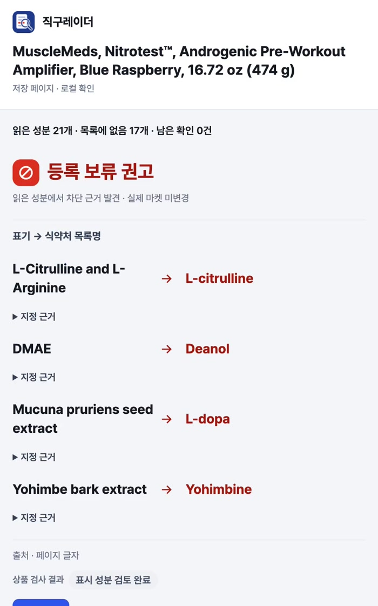
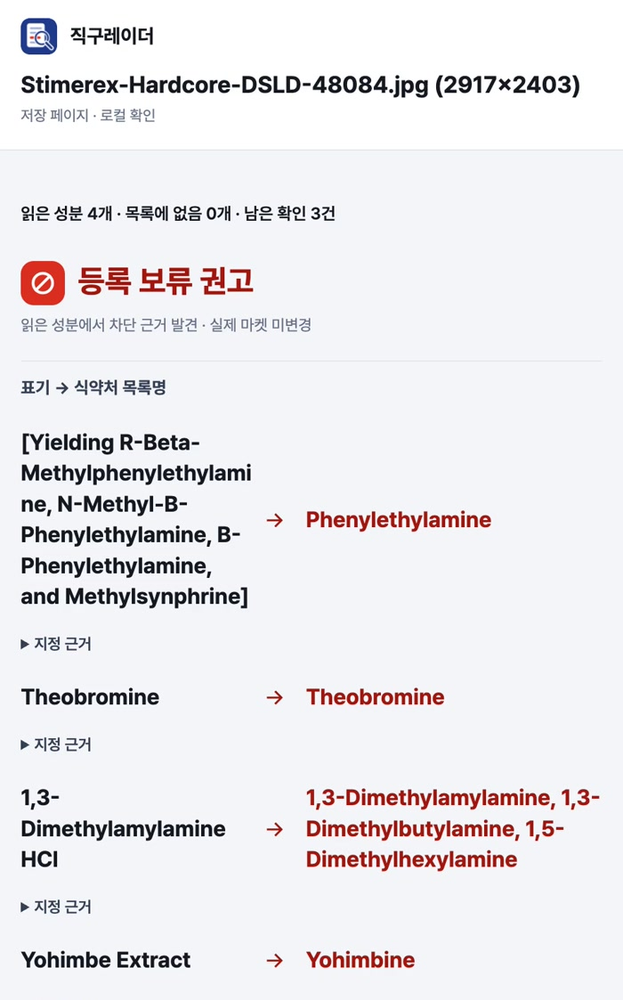
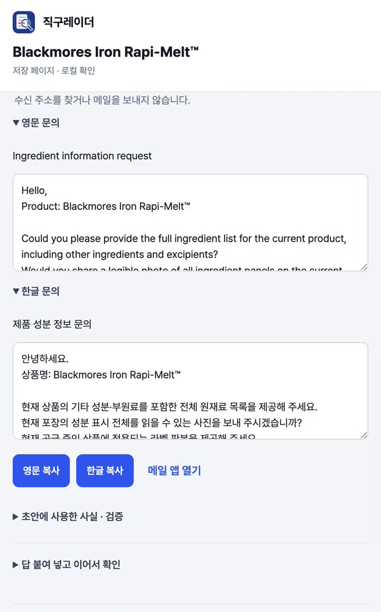
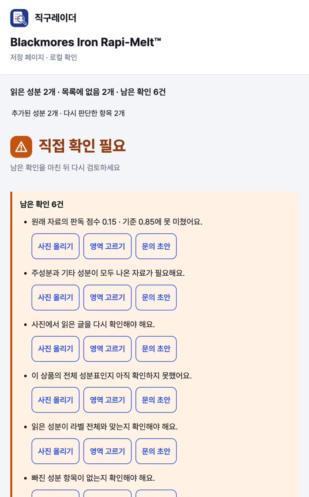
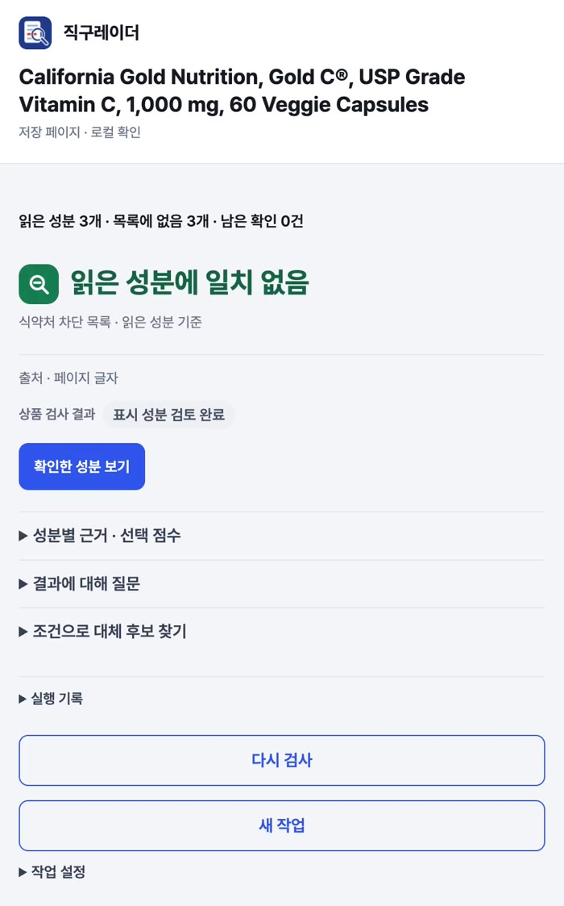
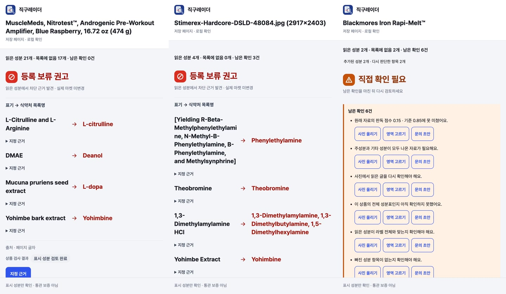

# 직구레이더 데모를 보며 읽는 법

**한 쪽 요약 · 0430 실행 / 116.76초 원본**

아래 시간과 정지 화면은 **최초 116.76초 편집본** 기준이다. 제출용 재편집 영상의 시간표는 [영상 안내](README.md)를 본다. 같은 0430 실행이므로 원본 사건 번호는 그대로다.

공개 저장소에는 직접 만든 결과 패널만 싣는다. 상품 화면과 원본 라벨은 각 장면의 원출처에서 확인한다.

판매자가 확인할 것은 ‘이 상품이 안전한가?’라는 막연한 질문이 아니다. **지금 팔 상품의 라벨에서 무엇을 읽었고, 어느 줄이 식약처 목록과 맞으며, 아직 무엇을 더 받아야 하는가?** 같은 도구에 글, 누운 라벨, 제품 앞면을 주면 검사 과정이 달라진다. 세 장면 모두 **다음 단계는 코드가 선택한다.** Zoro-1은 갈림길에서 자료를 읽을 만한지 판단하고, 애매한 원료를 살피거나 문의 글을 쓴다.

| 재생 시각 | 어디를 보나 | 한 가지 기억할 것 |
|---|---|---|
| 0:00–0:16 | 상품 표와 식약처 원료 목록 | DMAE와 디아놀은 같은 원료의 다른 표기 |
| 0:16–0:29 | 글 성분표와 오른쪽 빨간 결과 | 21개 대조, 4개 근거, 질문 0 |
| 0:29–1:01.60 | 옆으로 누운 사진과 결과 | 4개 근거를 찾았지만 전체는 미완료 |
| 1:01.60–1:45.56 | 앞면 → 문의문 → 답 사진 | 두 성분을 더 읽고도 직접 확인이 남음 |
| 1:45.56–1:51.64 | Gold C의 초록 결과 | 읽은 3개에서 미발견, 판매 허가 아님 |
| 1:51.64–1:56.76 | 나란한 세 결과 패널 | 빨강 둘, 주황 하나. 확인한 범위가 다름 |

## 영상을 틀기 전에: 어떤 화면이고 어디까지 실제인가

**재생 시간.** 원래 영상은 2880×1676, 116.76초, 무음이다. 이 설명서의 시간은 **첫 편집본의 처음을 0초로 잡은 재생 시간**이다. 서버 로그에 적힌 새벽 시각이나 상품 하나의 API 지연과 다르다.

**정지 화면.** 본문 그림은 위 영상의 해당 초를 직접 추출했다. ‘패널 확대’는 같은 영상의 오른쪽을 잘라 글자가 읽히게 한 것이다. 화면에 가짜 버튼·근거·모델 점수를 덧그리지 않았다. 전체 장면에서는 왼쪽이 보통 자료, 오른쪽이 검사 패널이다. 예외가 둘 있다. 처음 오른쪽은 **식약처 공개 검색 화면**, 마지막은 상품 페이지 없이 **결과 패널 세 개**다.

**원장 찾기.** [A: Nitrotest](../logs/scenario-01.jsonl), [B: Stimerex](../logs/scenario-02.jsonl), [C: Rapi-Melt](../logs/scenario-03.jsonl)에서 행 번호를 찾는다. 예를 들어 [C 110행](../logs/scenario-03.jsonl#L110)은 셋째 사건에서 새 자료를 반영한 이벤트다. 공개 사본에는 주소·인증값을 가리고 원래 사진 대신 지문과 치수를 넣었다. 실제 모델을 호출했지만 상품 페이지는 보존 자료이고, ‘모름’ 응답과 추가 사진 제공은 시험 각본이다. Gold C는 세 주 사건 밖의 보조 사례다.

**회색과 검은색은 결과 색이 아니다.** Rapi-Melt 판매 페이지에서 상품명 아래의 회색 막대는 저장된 판매처 HTML에 남은 로딩용 자리다. 실제 자료에 `animate-pulse`와 `bg-grey-50` 빈 칸이 있다. 가려진 금지 원료나 모델의 요약 결과가 아니다. 화면 아래·가장자리의 검은 공간은 서로 높이가 다른 페이지와 패널의 원본 캡처를 나란히 붙일 때 남긴 여백이다. 녹화 명세는 빈 공간만 채웠고 결과 변경·화면 늘임·배속은 하지 않았다고 기록한다. 녹색·적색·주황색 판정은 이 여백이 아니라 오른쪽 패널의 **글자**로 구별한다.

## 0:00–0:16 | 문제: 한 줄을 왜 두 화면에서 찾아야 하나

**한 문장.** 운동 전에 먹도록 판매되는 미국의 분말 보충제 NitroTest 한 통을 올리려 해도, 판매자는 한국 목록의 이름과 영문 라벨 이름을 연결해야 한다.

**0–8초:** 왼쪽 상단 녹색 iHerb 머리글 아래 `MuscleMeds, Nitrotest … Blue Raspberry` 제품을 본다. 474 g짜리 파란 라즈베리 맛 한 상품이다. 왼쪽 밑의 쿠키 안내나 할인 배너는 라벨이 아니다. 오른쪽은 ‘해외직구식품 국내 반입차단 원료·성분’ 검색 화면이다. 질문은 “이 제품 **이름**이 올라 있나?”가 아니라 “이 상품 성분표에 **지정 원료**가 있나?”다.

**8–16초:** 왼쪽 `Supplement facts`는 1회 제공량과 원료·함량을 적은 표다. 혼합물 제목 아래 `DMAE (Dimethylaminoethanol) bitartrate 350 mg` 줄을 찾는다. 오른쪽의 ‘원료·성분 명칭’ 칸으로 검색한 표 한 행에 `디아놀`, `Deanol`, `DMAE(Dimethylaminoethanol)`가 나란히 있다. 디아놀은 여기서 식약처 목록의 한국 이름, DMAE는 제품에 쓰인 이름이다. 350 mg은 제품의 표기 함량이지 판정 확률이 아니다. 전체 318행과 지정 316행의 차이는 해제된 2행을 포함하는지 여부다. **이 검색 결과가 1행인 것**과 목록 전체가 316행인 것은 다른 수다.

**누가 했나.** 저장된 상품과 실제 공식 목록 화면을 나란히 띄워 등록 전에 사람이 해야 할 이름 대조를 보여 줬다(A 2–3행). 이 구간은 Zoro-1의 새로운 성분 판정도, 후면 사진의 OCR도 아니다. 공식적으로 연결된 이름은 코드로 대조할 수 있다. 관객이 알아야 할 어려움은 사진, 판본, 별도 구역에 흩어진 **대조할 자료를 갖췄는지**다.

**발표할 말:** “왼쪽 라벨에는 DMAE, 오른쪽 한국 원료 목록에는 디아놀이라고 적혀 있습니다. 지금 보는 건 두 이름이 왜 연결되는지 판매자가 직접 확인해야 하는 순간입니다.” **피할 말:** “316개를 매번 사람이 전부 눈으로 훑는다”, “AI만 이명을 찾는다”, “상품명이 목록에 없으니 안전하다.”

**심사 질문 — ‘색칠 확장으로 되지 않나요?’** 이 줄은 된다. 대표명뿐 아니라 공식 이명까지 넣은 규칙은 별도 선별 사례 여섯 개 모두 찾았다. 이 영상의 주장은 어려운 이명을 창조한다는 것이 아니라 **자료가 달라질 때 다음 확인으로 이어 간다**는 것이다.

## 0:16–0:29 | 장면 1: 글로 된 성분표를 건너뛰지 않는다

**한 문장.** 이미 읽을 수 있는 성분표가 있으면, 판매자에게 사진을 또 달라고 하지 않고 근거가 나온 줄부터 보여 준다.

**16.00–18.20초:** 오른쪽 화면이 공식 목록에서 직구레이더로 바뀐다. 검사 시작 대상은 바로 앞의 Blue Raspberry 맛이다. 왼쪽 표에 그어진 테두리는 내용을 추출한 위치다. 이름이 비슷한 다른 맛이나 추천 상품에서 가져온 문장이 아니다. 앱은 저장 페이지의 글을 받아 사진 후보를 고르지 않고 진행했다(A 4–11행).

**18.20–25.50초:** Zoro-1이 읽은 글에 대해 `readable` 0.9428, 반대 보기 0.0572를 냈다(A 18행). 두 보기 사이의 선택 점수이지 성분 검사 정확도 94.28%가 아니다. 코드는 ‘확보한 범위 대조’로 진행하고 조건을 확인해 제공 자료 범위가 완전하다고 기록했다(A 20–24행). 전체 성분표였다고 실제 판매자가 답한 게 아니다. 제품 분류 0.5647도 별도 판단이다(A 30행). 판독·분류·차단을 같은 수로 읽으면 안 된다. 규칙으로 끝나지 않은 성분 여섯은 모델 판단을 받았다(A 76·84·92·100·108·116행). 이 여섯이 금지 성분 네 개라는 뜻은 아니다.

**25.50–29.00초:** 오른쪽 큰 빨강 **‘등록 보류 권고’**가 뜬다. 그 위 수치는 **읽은 성분 21개 · 목록에 없음 17개 · 남은 확인 0건**이다. 21은 대조한 항목 수이고, 그중 17개는 이번 목록에 맞는 차단 근거가 없다는 뜻이다. 0은 제공된 이 자료에서 남은 확인 건수이지 ‘어떤 검사도 필요 없다’는 뜻이 아니다. 실제 마켓 등록 상태는 바꾸지 않았다. 결과는 A 123–124행이다.

**‘표기 → 식약처 목록명’ 읽는 법.** 화살표 왼편은 판매 라벨의 글, 오른편은 공식 대조 항목이다. L-Citrulline and L-Arginine 혼합물에서는 **시트룰린**이 대응한다. DMAE는 **디아놀**의 다른 이름이다. Mucuna pruriens seed extract의 해당 원문에는 **L-dopa(엘도파)를 포함한다**고 적혀 있다. Yohimbe bark extract도 **Yohimbine(요힘빈)** 표시와 연결된다. 같은 식물 이름을 쓰는 모든 상품에 똑같은 성분이 있다고 확대하지 않는다. 원장 A 39·45·50·52행의 일치 판단은 공식 이름·이명을 확인한 **코드**가 했다. OCR 호출은 이 장면에 필요 없었다.

**발표할 말:** “같은 라벨을 넣었더니 읽은 21개 가운데 네 줄이 지정 근거와 연결됐습니다. 글이 이미 충분해 추가 사진이나 답을 요청하지 않았고, 화면은 실제 마켓을 바꾸지 않고 등록 보류를 권합니다.” **피할 말:** “모델이 혼자 금지 성분 네 개를 발견했다”, “남은 확인 0은 법적으로 조사 완료다.”

**심사 질문 — ‘모델이 굳이 필요한가요?’** 이 장면만 보면 규칙으로도 상당 부분 가능하다. 글이 있는 사례에서도 공식 일치는 규칙이 맡고, 모델은 자료 판독성과 애매하게 남은 성분을 판단한다. 다음 장면의 자료를 보면 같은 순서로 무조건 끝낼 수 없는 이유가 드러난다.

## 0:29–1:01.60 | 장면 2: 누운 사진을 읽었지만 전체 검토는 남는다

**한 문장.** 사진 속 어느 줄에 지정 근거가 있다는 사실과 사진 전체가 믿을 만하다는 판단은 다르다. 그래서 **빨간 등록 보류와 미완료**가 동시에 맞다.

**29.00–54.30초:** 왼쪽 위 검은 포장과 아래 청록색 성분 표시를 찾는다. 지금은 쇼핑 페이지의 문자 표가 아니라 **NIH DSLD 48084에 보존된 큰 JPEG(2917×2403)**다. 사진은 직접 제공한 것이며 모델이 웹에서 새로 찾지 않았다. 오른쪽은 진행 상태라 결과가 금방 뜨지 않는다. 읽기 도구 안에서 방향 판단이 일어난다. 옆으로 누움 0.6553, 후보 각도 중 90도 0.3490(B 13행)이었다. 코드는 읽기 도구 안에서 그 방향으로 사진을 준비하고 GravityOCR-KO가 61줄을 읽었다(B 14–18행). **‘에이전트가 다음 행동으로 회전을 골랐다’는 사건은 없다.**

**54.30–58.50초:** Zoro-1은 이번 글을 `읽을 만함` 0.9479, 범위가 완전해 보임 0.8809, 사진을 쓸 만함 0.8810으로 봤다(B 25–26행). 하지만 B 18행의 OCR 평균 줄 신뢰도 0.973과 반복 비율 0.541을 보면 같은 경고 글이 반복돼 전체 확인 조건을 못 채운다. **코드**가 재독을 한 번 선택했고(B 27–30행), 반환된 OCR 요청 ID도 `05b699131f4a`로 같았다. 새로 얻은 줄이 없어서 원래 자료를 유지했다. 코드는 영역을 묻고 실행기가 **‘모름’**으로 답했다(B 32–37행). 한 번의 실제 판매자 참여가 아니며 질문 0건인 장면도 아니다. 코드가 멈추고 문의할 **사유**만 기록했다(B 39–44행). 이 장면에서 영문 문의문을 생성한 것은 아니다.

**58.50–61.60초:** 빨간 결과의 맨 위는 **읽은 성분 4개 · 목록에 없음 0개 · 남은 확인 3건**이다. 읽힌 범위에서 확실한 지정 근거 네 개를 보인 것이지 이 상품에는 성분이 딱 네 개라는 말이 아니다. 오른쪽 패널의 긴 각괄호 묶음은 블렌드(여러 원료를 한 이름 아래 나열한 혼합물)의 자식 표기다. 테오브로민, `1,3-Dimethylamylamine`(DMAA), 요힘베 껍질 등 네 근거를 코드가 공식 이름·이명과 맞췄다(B 46–53행). 쉼표가 있는 `1,3-`을 서로 다른 두 성분처럼 자르면 안 된다. `98% Extract`의 퍼센트도 혼합물 안의 나열을 끝내는 표시가 아니다. B 56행의 최종 판단은 **일부 자료의 차단 근거, 전체 범위 미완료**다.

**발표할 말:** “돌아간 사진을 읽어 혼합물 안에서 네 가지 지정 근거를 확인했습니다. 그런데 전체 표를 믿을 만큼 읽은 건 아니라서 한 번 더 요청했고, ‘모름’ 뒤에도 전체 확인은 남겼습니다.” **피할 말:** “재시도가 성공해서 네 개를 더 찾았다”, “0.95니까 95% 안전하다”, “이 사진은 사람 질문 없이 끝났다.”

**심사 질문 — ‘화면이 멈춘 게 아닌가요?’** 실제 방향 판단과 OCR이 걸린 시간이다. 최종 원장에서 방향을 포함한 System 1 HTTP 2회, 실제 OCR HTTP 1회, 별도의 긴 생각 모드 0회가 확인된다. 도구에서 같은 결과를 꺼낸 회수를 새 원격 판독으로 세지 않는다. 끝에 나오는 ‘등록 보류’는 행정 처분이 아니라 판매자에게 주는 권고다.

## 1:01.60–1:45.56 | 장면 3: 모를 때 무엇을 물어야 하는지 적는다

**한 문장.** 앞면밖에 없으면 ‘걸리는 성분 없음’으로 끝내지 않는다. 필요한 자료를 요청하는 초안을 만들고, 추가 사진이 오면 이전 사건에 붙여 새로 읽힌 부분만 판단한다.

**61.60–71.83초:** 왼쪽 상단 `Blackmores`, 중간 제품명 `Iron Rapi-Melt`를 본다. 호주 브랜드의 입에서 녹여 먹는 철분 제품이다. 제품 소개나 앞면을 봤다고 전체 원재료를 확보한 것이 아니다. 오른쪽 앱에 들어간 첫 자료는 **제공된 앞면 사진**이다. 왼쪽의 회색 막대는 페이지의 로딩용 자리이지 투입한 앞면 사진이나 가린 성분표가 아니다. 글자 읽기는 11줄을 반환했지만(C 26행), 성분표로 읽을 수 있느냐는 다른 문제였다.

**71.83–75.865초:** 모델 응답은 ‘읽을 만함’ 0.1496 / **‘읽을 만하지 않음’ 0.8504**다(C 33–34행). 자막의 ‘근거 부족 0.85’는 이때의 부정 선택을 반올림한 값이다. 패널의 ‘판독 점수 0.15, 기준 0.85’에서 0.85는 **코드의 긍정 판독 문턱**이다. 우연히 비슷하게 보이지만 하나는 관측값, 다른 하나는 기준이다. 코드는 재독했으나 같은 요청의 결과여서 새 줄을 얻지 못했다(C 35–38행). 영역을 물었고 실행기가 ‘모름’으로 답했다(C 40–44행). 첫 결과는 직접 확인(C 53행). ‘영역 없음’을 대신 눌러 통과시킨 것이 아니다.

**75.865–79.024초:** 오른쪽 패널 위 `영문 문의`, 그 아래 `한글 문의`를 본다. `Ingredient information request`는 제품 성분 정보 요청이라는 뜻이다. 실제 문장은 현재 공급품의 **기타 성분·부원료를 포함한 전체 목록과 읽기 좋은 라벨 사진**을 달라고 한다. 코드는 이 사건에서 무엇이 빠졌는지 추렸고, Zoro-1이 양국어 문의문을 쓴 뒤 검사에서 채택됐다(C 61–66행). 바로 아래에 `영문 복사`, `한글 복사`, `메일 앱 열기`가 있다. **메일 앱 열기와 메일 발송은 다르다.** 보내는 주소를 찾거나 자동 발송한 기록은 없다.

**79.024–101.80초:** `답 붙여 넣고 이어서 확인` 경로로 준비해 둔 추가 사진을 준다(C 69–73행). 명칭은 ‘제조사 답 자료’ 경로지만 실제 제조사가 메일로 보낸 사진은 아니다. 이미 실행한 **동일 사건 `1120-041820-dd2b`**에 붙었다. 오른쪽은 재처리 진행으로 바뀌고, 원격 OCR이 15줄을 읽었다(C 91행). 그중 `Iron amino acid chelate (iron 8 mg) 40 mg`과 `Ascorbic acid (vitamin C) 30 mg` 두 줄이 새 원료 근거다. 첫 줄은 킬레이트 화합물 **40 mg 중 철 8 mg**, 두 번째는 비타민 C의 화학명 아스코르브산 **30 mg**이다. 철 자체가 40 mg이라고 읽지 않는다.

**101.80–105.56초:** 추가 항목 두 개에서 차단 근거 없음 선택 점수는 각각 **0.9464와 0.9700**(C 98·106행). C 110행은 `added` 두 개, `rejudged` 두 개다. 새로운 상품 두 개를 검사한 게 아니다. 최종 패널은 **읽은 성분 2개 · 목록에 없음 2개 · 남은 확인 6건**이다. 주황 영역은 원래 자료 판독, 주성분과 기타 성분, 사진 재확인, 현재 표의 범위, 줄 대응, 빠진 항목을 확인하라고 남긴다. ‘남은 6’은 금지 성분이 6개 있다는 뜻도, 제조사에 이메일을 여섯 번 보내라는 뜻도 아니다.

**발표할 말:** “앞면에서는 성분을 확인할 수 없어 필요한 자료를 묻는 영문·한글 초안을 만들었습니다. 준비한 답 사진을 같은 검사에 붙여 철과 비타민 C를 새로 대조했습니다. 부원료 전체까지 확인된 건 아니라 결과는 여전히 직접 확인입니다.” **피할 말:** “제조사가 답장을 보내 주었다”, “철분제라 안전하다”, “메일을 자동으로 보냈다.”

**심사 질문 — ‘최종 배지가 그대로면 아무 개선도 없는 것 아닌가요?’** 처음에는 대조할 원료 근거가 없었고, 끝에는 새로 확인된 두 성분의 이름과 해당 줄이 있다. C 53행과 110–111행을 비교하면 같은 결론 안에서 새로 알게 된 것과 여전히 모르는 것이 갈린다. 이 구분이 있어야 다음 사람이 같은 일을 처음부터 되풀이하지 않는다. 실제 판매자가 몇 분을 아꼈는지는 이 영상에서 재지 않았다.

## 1:45.56–1:51.64 | 보조: 평범한 비타민 C의 초록색 읽기

**한 문장.** 차단 근거가 나오지 않았을 때 앱이 약속하는 범위는 **읽고 대조한 표시 성분**까지다.

**105.56초에** Gold C로 전환한다. California Gold Nutrition의 비타민 C 1,000 mg 식물성 캡슐 60개 제품이다. 왼쪽 자료에서 `Supplement Facts` 아래 비타민 C 표를 찾는다. 제품명에 C가 있으니 추정한 게 아니다. 오른쪽 위 제품명이 맞는지 보고 가운데 초록 문구와 바로 위 건수를 읽는다. **111.64초 전까지** 결과가 보인다. 보조 사건은 `1120-041905-925a`다.

**실제로 한 일.** 코드가 페이지 글을 읽고, Zoro-1의 판독 가능 점수 0.8819(보조 16행) 뒤 코드가 자료 범위를 확인했다(18·22행). `Vitamin C (as Ascorbic Acid)`는 주성분, `Modified Cellulose (Hypromellose Veggie Capsule)`는 캡슐에 쓰인 성분, `Magnesium Stearate`는 스테아르산마그네슘이다(33–36행). 실제 응답한 판매자 0명, 질문 0회. 사진을 OCR해서 표를 채운 장면이 아니다.

**화면과 원장 문구가 조금 다른 이유.** 화면은 ‘읽은 성분에 일치 없음’, 보조 51행 원장은 ‘읽은 범위에서 찾지 못함’이라고 쓴다. 둘 다 **읽은 성분 3개 / 목록에 없음 3개 / 남은 확인 0건**인 이번 대조의 결과다. `확인한 성분 보기`를 누르면 무엇을 대조했는지 확인하는 버튼이지 마켓 등록 버튼이 아니다.

**발표할 말:** “이 제품은 페이지에 적힌 세 성분을 대조했고 지정 원료와 맞는 것이 없었습니다. 그래서 ‘읽은 성분에 일치 없음’이라고 적습니다. 이 제품의 모든 로트가 판매 가능하다는 말은 아닙니다.” **피할 말:** “식약처 인증”, “100% 안전.” **심사 질문 — ‘왜 실험 세 건인데 네 상품이죠?’** Gold C는 짧은 **보조 대조**이며 대응 원장도 별개다. 본편 세 사건이나 25상품 평가의 분모에 새 상품을 더한 것이 아니다.

## 1:51.64–1:56.76 | 정리: 같은 빨강 두 개도 다르다

**한 문장.** 색보다 그 위의 성분 수·남은 확인 수, 그 아래의 원문 근거를 읽어야 한다.

**111.64초**부터 세 결과를 같은 화면에 놓고 **116.76초**에 끝난다. 왼쪽 NitroTest는 네 지정 근거와 남은 확인 0, 가운데 Stimerex는 네 근거가 있지만 남은 확인 3, 오른쪽 Rapi-Melt는 추가 사진 뒤 두 성분을 대조하고도 남은 확인 6이다. 가운데 패널의 긴 이름은 혼합물 자식 원료, 오른쪽 주황색은 다음 확인 항목과 관련 버튼이다. 보조 Gold C는 이 세 칸에 들어있지 않다. 화면 크기나 비율이 다른 칸의 여백은 판정이나 가려진 근거가 아니다.

**누가 한 일인가.** 이 마지막 5.12초에 세 상품을 다시 돌리지 않았다. 같은 0430 촬영의 실제 결과 세 개(A 124행, B 56행, C 111행)를 나란히 조립했다. 새 모델·OCR·판매자 답변은 없다. 마지막 장면을 세 개 모두 ‘완료’라고 집계할 수 없다.

**발표할 말:** “왼쪽 둘은 등록 보류지만 근거의 범위가 다르고, 오른쪽은 읽어 낸 두 성분과 남은 일이 동시에 보입니다. 판매자가 받는 것은 허가 도장이 아니라 지금 어디까지 확인했는지 보여 주는 기록입니다.” **피할 말:** “전 상품 자동 처리 성공”, “세 명의 판매자가 검증했다.” **심사 질문 — ‘그럼 실제 성능 수치는요?’** 이 세 영상은 과정 사례다. 별도 0430 개발 검증 25상품에서는 범위·정답 완료 8, 전 항목 해결 7, 양성 목표 ID 13/17, 실제 사람 0이었다. 영상 셋을 거기에 더해 28개로 세지 않는다.

## 왜 에이전트인가를 이 영상으로 설명하는 법

**첫 답은 ‘무엇이 다른 길을 만들었나’다.** 단순히 ‘빨간 카드가 나왔다’만 보여 주면 이름 조회 스크립트와 차이가 안 보인다. 처음 자료에서 얻은 관측, 남은 자료, 이미 쓴 도구, 답을 받았는지에 따라 **하나의 상품 사건이 다른 순서로 진행**되는 점을 보여 준다. 다만 이 0430판의 `code_selection`과 `next_action`에서 순서를 정한 주체는 모두 코드다. 모델이 행동을 마음대로 만들어 실행하지 않았다.

| 같은 검사 목표 | 확보한 자료와 판단 | 코드의 다음 단계와 실제 결말 |
|---|---|---|
| A · 글 성분표 | 본문 글 있음 → Zoro 판독 가능 0.9428 | 코드 범위 확인 → 이름·이명 대조, 일부 애매한 이름만 모델 판단 → 4개 규칙 일치 → 등록 보류. 사진·질문 없음 |
| B · 누운 라벨 | 제공 사진 → 읽기 도구 안에서 방향·회전 OCR → Zoro 판독 가능 0.9479, 반복 흔적 남음 | 코드 재독, 새 근거 없음 → 영역 요청 → 각본 ‘모름’ → 확보 작업 멈춤·문의 사유 기록 → 부분 자료에서 4개 규칙 일치 → 등록 보류, 범위 미완료 |
| C · 앞면뿐 | 제공 사진 OCR → Zoro 판독 불가 0.8504 | 코드 재독, 새 근거 없음 → 영역 요청·각본 ‘모름’ → 멈춤 → 실제 Zoro 문의문 → 제공 답 사진 → 같은 사건에서 OCR·두 성분 재판정 → 직접 확인 유지 |

**누가 어느 일에 책임지나.** 코드는 자료 확보 순서, 재시도 예산, 정확 이름·공식 이명 일치, 증거가 모자랄 때 완료 금지, 같은 사건에 자료를 붙이는 일을 맡는다. Zoro-1은 A의 자료 판독·분류·남은 성분 여섯 판단, B의 자료 판독 판단, C의 판독 불가 판단·문의 문장·답 자료 성분 판단을 실제로 했다. OCR은 사진의 픽셀을 글자로 만들었다. 사진 방향 제안도 읽기 도구 안의 판단이지 별도 ‘회전하라’는 상위 행동 선택이 아니다. 판매자만 알 수 있는 실물 판본·실제 회신 진위는 이 모의 판매자 역할로 검증하지 않았다.

**심사위원: ‘이걸 전부 미리 코드로 짜도 되지 않나요?’** “가능합니다. 실제로 이 버전에서는 순서를 코드로 정합니다. 에이전트라는 설명의 핵심은 모델이 모든 단계를 지시한다는 게 아니라, 관측과 실패를 기록하고 새 근거가 오면 같은 목표를 이어 가는 것입니다.” 모든 사진 OCR·공식 이명·근거 부족 보류를 갖춘 강한 규칙과 따로 비교했을 때 전체 자료 확보는 양식 변경 4/5 대 4/5, 알려진 다른 사이트 3/6 대 3/6, 처음 보는 사이트 0/6 대 0/6이었다. 사진 선별은 오히려 정식 표 5/6으로 전체 OCR 6/6보다 하나 뒤졌다. **‘페이지 글만 한 번 찾는 약한 도구’와 ‘강한 규칙’은 같은 기준선이 아니다.**

**맨 끝에서 할 말:** “어떤 상품은 글만 읽고 끝나고, 어떤 상품은 돌아간 사진을 읽어도 일부만 확인됩니다. 세 번째 상품은 답 사진이 오자 같은 사건을 다시 열어 두 성분을 확인했습니다. 우리는 그 갈림의 이유와 남은 일을 남겼습니다.”

**함께 볼 자료:** [세 장면 입력과 원출처](README.md) · [실제 요청 수](../logs/model-calls.json) · [촬영·제출 코드 구분](../README.md). 서로 다른 실행에서 얻은 점수는 바꿔 끼우지 않는다.
