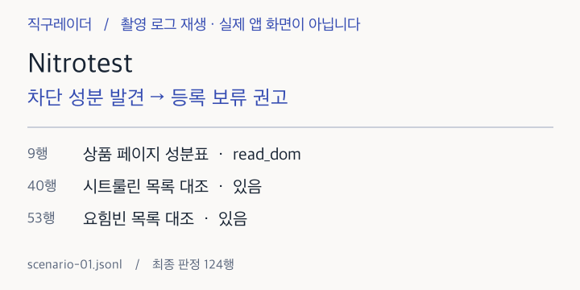

# 세 장면에서 볼 것

최종 녹화는 1분 56.68초이며 무음입니다. 영상 파일은 이 공개 저장소에 포함하지 않습니다. [자막 파일](film-ko.vtt) · [자막 원문](final-captions.md) · [세 장면과 결과 패널](DEMO-EXPLAINED.md)

[화면을 보며 읽는 상세 해설: 어디를 읽고 무엇을 물었나](DEMO-EXPLAINED.md)

1. [Nitrotest: 표에서 차단 근거 찾기](scenario-01.md)
2. [Stimerex: 사진과 판매자의 모름 답변](scenario-02.md)
3. [Rapi-Melt: 문의 후 같은 사건 재검사](scenario-03.md)

로그는 [촬영 원본 색인](../logs/run-index.json)에 있다. 각 장면에서 쓴 자료의 출처는 해당 설명에 적었다. 영상 주소가 확정되기 전에는 QR이나 임시 주소를 배포하지 않는다.

최종 편집 구간: 0–8초 문제 소개 · 8–15초 한 번 읽고 대조한 결과 · 15–28초 글 성분표(Nitrotest) · 28–60.60초 사진 성분표(Stimerex) · 60.60–104.56초 추가 자료를 받아 재판정(Rapi-Melt) · 104.56–111.56초 세 경로 비교 · 111.56–116.68초 실제 세 결과. 비교 카드는 실행 기록을 설명하기 위해 만든 화면이며 새로운 모델 출력이 아니다. [시간표](scene-timing.json) · [MP4 해시와 재생 검증](movie-proof.json).

상세 해설의 Gold C와 116.76초 시간표는 **최초 편집본**에만 나온다. 최종 편집본은 같은 0430 실행의 세 장면을 재사용하고, 보조 장면 대신 비교를 넣었다. 다시 추론하거나 0505 실행으로 바꾸지 않았다.
